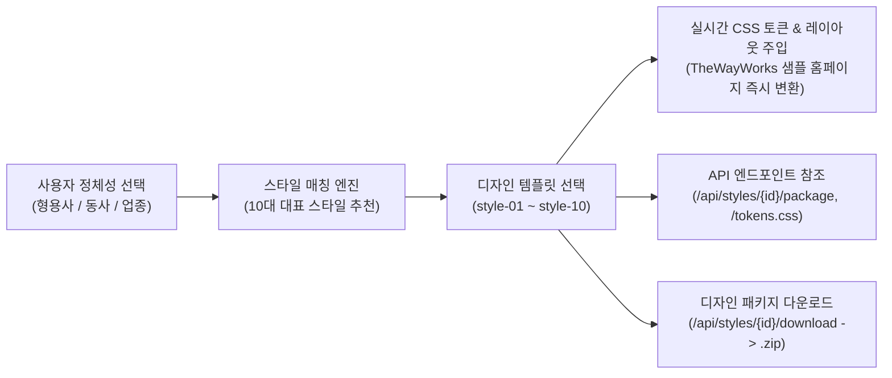

# Design Templates Helper 시스템 요구사항 정의서 및 구축 계획서 (2026-11-05 18:37)

---

## 1. 개요 및 구축 목표 (Overview & Objectives)

### 1.1 배경 및 목적
본 문서는 기존 `notes/requirement.md` 및 `notes/plan_202610292316.md`에 정의된 **10대 대표 디자인 스타일 메타데이터(`data/styles_metadata.json`)**와, `C:\Project\글쓰기\twayworks`에 구축된 **TheWayWorks(더웨이웍스) 기업 소개 자료 및 프로토타입 자산**을 결합하여 실제 작동하는 **Design Templates Helper 시스템**을 구축하기 위한 **최소 개발요구조건(MVP) 정의서 및 상세 구축 계획서**입니다.

### 1.2 핵심 목표 (3대 구축 축)
1. **TheWayWorks 기반 샘플 홈페이지 & 실시간 디자인/CI 변환기 구축**:
   - `C:\Project\글쓰기\twayworks`의 기업 콘텐츠(VAIYER, Snack App, Wisdom, Snap Company 4대 축, 6컷 카툰 파이프라인, 4대 코어 기술 부품, Holyseeds 12종 프로덕션 스낵 앱 카탈로그)를 샘플 홈페이지로 구성합니다.
   - 사용자가 기업의 **정체성(형용사·동사·업종)**을 선택하거나 **10대 디자인 템플릿**을 선택하면, 샘플 홈페이지의 **회사 CI(로고 마크, 컬러 팔레트, 타이포그래피, 톤앤매너 카피, 카드/보더/그림자 UI 토큰)**가 실시간으로 변환되어 정체성에 맞는 디자인을 즉시 비교·선택할 수 있습니다.
2. **디자인 패키지 참조 API 엔드포인트 제공 (REST API)**:
   - 외부 웹 애플리케이션, 스낵 앱 빌더, 또는 VAIYER/AI 코딩 에이전트가 선택된 디자인 템플릿의 메타데이터, CSS 디자인 토큰(`tokens.css`), AI 디자인 시스템 프롬프트 및 패키지 명세를 URL 호출만으로 참조할 수 있는 표준 API 엔드포인트를 제공합니다.
3. **디자인 템플릿 패키지(`.zip`) 원클릭 다운로드 제공**:
   - 선택된 디자인 스타일이 적용된 샘플 홈페이지 코드(`index.html`, `styles.css`, `app.js`, `img/`), 디자인 토큰(`design-tokens.css`), 스타일 메타데이터(`style-metadata.json`), 회사 CI 및 AI 코딩 가이드(`CI_AND_STYLE_GUIDE.md`)를 하나의 `.zip` 패키지로 묶어 즉시 다운로드할 수 있는 기능을 제공합니다.

---

## 2. Design Helper 시스템 최소 개발요구조건(MVP) 정의서

시스템이 반드시 충족해야 할 최소 개발요구조건을 **기능 요구사항(FR)**과 **데이터/비기능 요구사항(NFR)**으로 구분하여 정의합니다.

### 2.1 기능 요구사항 (Functional Requirements)

| 요구사항 ID | 요구사항 명칭 | 상세 정의 및 필수 구현 내용 | 우선순위 |
|:---:|:---|:---|:---:|
| **FR-01** | **정체성 기반 스타일 탐색 및 추천 (Identity Finder)** | - `data/styles_metadata.json`에 정의된 10대 스타일의 **형용사(Adjectives)**, **동사(Verbs)**, **적합 업종(Target Businesses)** 키워드 필터 제공<br>- 사용자가 우리 회사를 표현하는 형용사/동사를 선택하면 매칭 점수를 계산하여 가장 적합한 디자인 템플릿 순위를 추천 | **필수(P0)** |
| **FR-02** | **TheWayWorks 샘플 홈페이지 구축 및 동적 스타일/CI 변경** | - `C:\Project\글쓰기\twayworks`의 5대 메뉴(HOME, 01.회사소개, 02.쉬운 기술원리, 03.맞춤 솔루션, 04.실제 작동사례, 05.3분 무료진단)와 13개 이미지/SVG 에셋을 완벽히 통합한 샘플 홈페이지 구동<br>- 상단/사이드 **Design Helper 컨트롤러 바(Dock/Drawer)**를 통해 10대 대표 스타일(+TheWayWorks 기본 오리지널 테마) 선택 시, 페이지 새로고침 없이 **색상(Primary/Secondary/Accent/Bg/Surface/Text), 폰트(Heading/Body/Mono), 컴포넌트 스타일(Border/Radius/Shadow), CI 로고 배지 및 톤앤매너 샘플 슬로건**이 즉시 변경됨 | **필수(P0)** |
| **FR-03** | **회사 CI & 디자인 토큰 인스펙터 (CI & Token Inspector)** | - 현재 선택된 디자인 템플릿의 **정체성 정의(형용사 6개, 동사 5개, 톤앤매너 설명, 샘플 카피)**, **색상 스와치(HEX 원클릭 복사)**, **폰트 스택**, **레이아웃/UI 규칙**, 그리고 **API 참조 엔드포인트 URL**을 한눈에 확인하는 인스펙터 모달/패널 제공<br>- 회사명(기본값: `TheWayWorks`), 태그라인, 대표 슬로건을 사용자가 수정하면 샘플 홈페이지 CI와 다운로드 패키지에 즉시 반영되는 라이브 커스터마이징 지원 | **필수(P0)** |
| **FR-04** | **디자인 패키지 참조 API 엔드포인트 제공** | - 타 시스템이나 웹앱 개발 시 디자인 패키지를 프로그래밍 방식으로 조회·참조할 수 있는 RESTful API 제공:<br>  1) 전체 스타일 목록 및 검색 API (`/api/styles`)<br>  2) 단일 스타일 상세 메타데이터 API (`/api/styles/{style_id}`)<br>  3) 정체성 키워드 기반 추천 API (`/api/styles/recommend`)<br>  4) 외부 웹앱 `<link>` 태그로 즉시 임포트 가능한 동적 CSS 토큰 API (`/api/styles/{style_id}/tokens.css`)<br>  5) 스타일 패키지 통합 JSON 참조 API (`/api/styles/{style_id}/package`) | **필수(P0)** |
| **FR-05** | **디자인 템플릿 패키지 ZIP 다운로드 기능** | - 선택된 디자인 템플릿(`style_id`)과 커스텀 CI 설정이 적용된 완제품 스타터 키트를 인메모리(In-memory) `.zip` 아카이브로 생성하여 다운로드(`GET /api/styles/{style_id}/download`)<br>- 다운로드된 압축 파일 해제 즉시 로컬에서 실행 가능한 TheWayWorks 샘플 홈페이지 + 디자인 토큰 + AI 프롬프트 가이드 포함 | **필수(P0)** |

### 2.2 비기능 및 아키텍처 요구사항 (Non-Functional Requirements)
- **NFR-01 (경량성 및 무의존성 실행)**: Python 표준 라이브러리 및 경량 웹 프레임워크(`FastAPI` + `Uvicorn` 또는 `Flask`) 기반으로 단일 명령어(`python app.py`)로 즉시 서버 구동 및 API 문서(Swagger UI `/docs`) 자동 제공.
- **NFR-02 (CSS 변수 아키텍처 표준화)**: 샘플 홈페이지(`styles.css`)의 모든 색상, 서체, 테두리, 곡률, 그림자를 표준 CSS Custom Properties(`--dh-color-primary`, `--dh-font-heading`, `--dh-radius-card` 등)로 추상화하여 어떤 스타일 템플릿이 선택되더라도 깨짐 없이 즉각 반응형으로 렌더링.
- **NFR-03 (CORS 허용 및 외부 참조 호환성)**: 외부 스낵 앱이나 웹앱에서 `/api/styles/{style_id}/tokens.css` 및 `/api/styles/{style_id}/package`를 직접 호출/링크할 수 있도록 CORS(`Access-Control-Allow-Origin: *`) 헤더 기본 지원.

---

## 3. 샘플 홈페이지 (TheWayWorks) 구성 및 동적 변환 설계

### 3.1 `C:\Project\글쓰기\twayworks` 기반 샘플 홈페이지 콘텐츠 구성
샘플 홈페이지는 TheWayWorks의 실제 비즈니스와 기술 자산을 그대로 담고 있는 **멀티 뷰(SPA 라우팅) 기업 홈페이지**로 구성합니다.

1. **GNB 헤더 및 회사 CI 영역**:
   - TheWayWorks 로고 마크(`W`), 기업명(`TheWayWorks`), 태그라인(`THE WAY WORKS · AI APP BUILDER`) 및 6개 메인 네비게이션 탭.
   - **[Design Helper 연동]**: 선택된 스타일에 따라 로고 마크의 형태(직각/라운드/브루탈리즘 보더/골드 엠블럼 등)와 헤더 배경 블러/보더 스타일이 동적으로 변화합니다.
2. **VIEW 0: 메인 홈 (`#view-home`) — 8개 스토리텔링 섹션**:
   - **Section 1 (Hero)**: *"말 한마디로 내 노하우를 연결하면, 오늘 바로 쓰는 나만의 비즈니스 앱이 됩니다. THE WAY WORKS."* + 우측 4단계 실전 파이프라인 카드 (`Vibe 한 줄 요청 → 시나리오 & Logical Wiring → Wisdom 지식화 → 스낵 앱 배포 & Snap Company 완성`).
   - **Section 2 (Cartoon Pipeline)**: `img/cartoon-pipeline-v02.svg` 기반 6컷 카툰 스토리보드 및 6단계 카드 해설.
   - **Section 3 (The 4 Pillars)**: `01. VAIYER (신경망/배선)`, `02. Snack App (손발/도구)`, `03. Wisdom (똑똑한 두뇌)`, `04. Snap Company (완성된 1인 기업)` 4대 핵심 축 카드.
   - **Section 4 (Deep Dive 1 - VAIYER & 4대 핵심 부품 탭 뷰)**: 3층 조립 시스템(Vibe-Wiring-Ops) + 실제 스크린샷 기반 4대 기술 부품 인터랙티브 탭(`FOTOSTREAM`, `VDSTREAM`, `ShortURL`, `Proxy Auth`).
   - **Section 5 (Deep Dive 2 - Wisdom Engine)**: DIKW 4단계 요리 비유 피라미드 + 두 명의 검수원(`규칙 대장 Rule 파서` × `맥락 박사 LLM 파서`) 교차 검증 UI.
   - **Section 6 (Live Proof - 12종 프로덕션 카탈로그)**: `holyseeds.thewayworks.net`에서 실제 가동 중인 12종 스낵 앱 카드 그리드 및 4대 실제 대시보드 캡처(`snap-app-01~04.png`) 갤러리.
   - **Section 7 (Target Solutions)**: 1인 기업(스냅 컴퍼니) / 중소·중견기업(Enterprise AX) / 교회·공익단체(스마트 처치) 3대 맞춤 솔루션.
   - **Section 8 (Bottom CTA)**: 3분 무료 진단 및 기술 나눔 신청 배너.
3. **VIEW 1 ~ 5: 5대 하위 상세 페이지**:
   - `01. 회사소개 (THE WAY)`: 브랜드 스토리, 4대 핵심 축 역할 표, 기독교 기업 가치 및 홀리씨즈 바자회(`giveNforget`) 스토리.
   - `02. 쉬운 기술원리 (TECHNOLOGY)`: VAIYER 5단계 표, Snack App 3대 강점, Wisdom Dual TOC 상세.
   - `03. 맞춤 솔루션 (SOLUTIONS)`: 1인 기업 스냅 컴퍼니 4단계 퍼즐, 기업 AX, 스마트 처치 4대 사역 패키지.
   - `04. 실제 작동사례 (PORTFOLIO)`: 카테고리 필터링이 가능한 12종 스낵 앱 전체 카탈로그, 4대 핵심 부품 쇼케이스, AI 비즈니스 칼럼 3선.
   - `05. 3분 무료진단 (CONTACT)`: 1인 기업 & 비즈니스 스낵 앱 주문서 폼 및 교회·공익 사역 지원 신청 폼.

### 3.2 정체성 기반 디자인 템플릿 실시간 변환 메커니즘 (Live Theme Engine)

TheWayWorks 샘플 홈페이지 상단(또는 플로팅 도크)에 **`Design Template & CI Helper Bar`**를 장착하여, 아래 **10+1개 스타일 템플릿**을 선택하면 홈페이지 전체가 즉시 변신합니다.



#### 스타일 변환 시 샘플 홈페이지에 동적 반영되는 요소
1. **컬러 시스템 전환 (`colors`)**:
   - `--dh-primary`, `--dh-secondary`, `--dh-accent`, `--dh-bg-main`, `--dh-bg-surface`, `--dh-text-main`, `--dh-text-muted`, `--dh-border` 변수가 선택된 스타일의 HEX 값으로 즉시 교체됩니다.
   - 라이트 테마(`style-01, 02, 03, 04, 06, 07, 09, 10`)와 다크 테마(`style-05 다크 퓨처 SaaS`, `style-08 럭셔리 프레스티지`) 전환 시 히어로 배경, 카드 표면, 텍스트 명도 대비가 자동 최적화됩니다.
2. **타이포그래피 전환 (`typography`)**:
   - 웹폰트(Pretendard, MaruBuri, Gmarket Sans, Space Grotesk, Playfair Display, Cormorant Garamond, Plus Jakarta Sans, JetBrains Mono 등)를 로드하여, 제목(`--dh-font-heading`), 본문(`--dh-font-body`), 포인트/코드(`--dh-font-accent`) 서체와 자간(`letter-spacing`), 굵기(`font-weight`), 행간(`line-height`)이 즉시 변경됩니다.
3. **UI 컴포넌트 & 보더/그림자 규칙 전환 (`template_definition.ui_components`)**:
   - 예: `style-01 (미니멀 에센셜)` 선택 시 → 모든 카드 곡률 `0px`, 그림자 제거(`none`), `1px solid #E5E5E5` 정제된 실선 그리드로 변환.
   - 예: `style-02 (테크 네오 브루탈리즘)` 선택 시 → 모든 카드와 버튼에 `3px solid #000000` 보더와 `5px 5px 0px #000000` 하드 섀도우 적용, 호버 시 눌리는 물리적 인터랙션 적용.
   - 예: `style-05 (다크 퓨처 & AI SaaS)` 선택 시 → 옵시디언 다크 배경(`#090A0F`) 위 반투명 글래스모피즘 벤토 카드와 네온 인디고 글로우(`0 0 35px rgba(99,102,241,0.25)`) 적용.
   - 예: `style-06 (에디토리얼 매거진)` / `style-08 (럭셔리 프레스티지)` 선택 시 → 우아한 세리프 헤드라인과 `1px` 헤어라인/샴페인 골드 보더 적용.
4. **정체성 배너 & 톤앤매너 카피 프리뷰 (`identity`)**:
   - 히어로 상단 또는 CI 프리뷰 바에 현재 적용된 스타일의 **형용사/동사 태그**, **톤앤매너 가이드**, **스타일별 샘플 슬로건**을 함께 표시하여 TheWayWorks의 메시지가 각 스타일의 어조에서 어떻게 전달되는지 비교할 수 있게 합니다.

---

## 4. 디자인 패키지 참조 API 엔드포인트 상세 명세 (API Specification)

외부 애플리케이션이나 개발 도구가 디자인 템플릿과 패키지를 참조할 수 있도록 아래 REST API 엔드포인트를 설계합니다.

| Method | Endpoint | 설명 | 응답 형식 |
|:---:|:---|:---|:---:|
| `GET` | `/api/styles` | 전체 10대 디자인 스타일 목록 조회 (쿼리 파라미터 `adjective`, `verb`, `business`, `scheme` 필터 지원) | `application/json` |
| `GET` | `/api/styles/{style_id}` | 특정 디자인 스타일의 전체 메타데이터(정체성, 색상, 타이포, 템플릿 구조) 상세 조회 | `application/json` |
| `POST` | `/api/styles/recommend` | 정체성 키워드(`adjectives`, `verbs`, `target_business`)를 전달받아 매칭 점수가 높은 상위 추천 스타일 목록 반환 | `application/json` |
| `GET` | `/api/styles/{style_id}/tokens.css` | 해당 스타일의 CSS Custom Properties(`:root` 디자인 토큰 및 기본 유틸리티 클래스)를 CSS 파일 형태로 직접 반환 (외부 웹앱 `<link rel="stylesheet">` 참조 가능) | `text/css` |
| `GET` | `/api/styles/{style_id}/package` | 해당 스타일의 **디자인 패키지 전체 데이터**(메타데이터 + `design-tokens.css` 전문 + `CI_AND_STYLE_GUIDE.md` 프롬프트 + HTML 컴포넌트 스니펫 + 다운로드 URL)를 JSON으로 반환 | `application/json` |
| `GET` | `/api/styles/{style_id}/download` | 선택된 스타일(및 쿼리 파라미터로 전달된 회사명/슬로건 커스텀 값)이 적용된 **전체 디자인 템플릿 패키지(`.zip`)** 파일 다운로드 | `application/zip` |
| `GET` | `/api/company/twayworks` | 샘플 홈페이지의 기준이 되는 TheWayWorks 기업 소개 구조 및 12종 프로덕션 스낵 앱 데이터 조회 | `application/json` |

### 4.1 주요 API 응답 예시 (`GET /api/styles/{style_id}/package`)
```json
{
  "style_id": "style-05-dark-future-saas",
  "name_ko": "다크 퓨처 & AI SaaS",
  "name_en": "Dark Future & AI SaaS",
  "company_context": {
    "company_name": "TheWayWorks",
    "tagline": "THE WAY WORKS · AI APP BUILDER"
  },
  "metadata": {
    "identity": {
      "adjectives": ["혁신적인", "미래지향적인", "압도적인", "정밀한", "몰입감 있는", "세련된"],
      "verbs": ["가속하다", "자동화하다", "혁신하다", "확장하다", "초월하다"],
      "tone_and_manner": "기술적 우위와 미래 비전을 간결하고 임팩트 있게 선언하는 어조."
    },
    "colors": { "primary": "#6366F1", "background": "#090A0F", "...": "..." },
    "typography": { "heading_font": "'Wanted Sans', 'Space Grotesk', Pretendard, sans-serif", "...": "..." }
  },
  "files": {
    "design_tokens_css": ":root {\n  --dh-color-primary: #6366F1;\n  ...\n}",
    "ci_and_style_guide_md": "# TheWayWorks CI & Design System Guide (Dark Future & AI SaaS)\n..."
  },
  "endpoints": {
    "self": "/api/styles/style-05-dark-future-saas/package",
    "tokens_css": "/api/styles/style-05-dark-future-saas/tokens.css",
    "download_zip": "/api/styles/style-05-dark-future-saas/download"
  }
}
```

---

## 5. 디자인 템플릿 패키지(`.zip`) 다운로드 구성 명세

사용자가 웹 UI에서 **`[📦 현재 디자인 템플릿 패키지 다운로드 (.ZIP)]`** 버튼을 클릭하거나 `GET /api/styles/{style_id}/download?company=TheWayWorks`를 호출하면, 서버가 실시간으로 아래 파일들이 포함된 ZIP 압축 파일을 생성하여 반환합니다.

```text
twayworks-{style_id}-package.zip
├── README.md                       # 패키지 사용법 및 빠른 시작(Quick Start) 안내
├── CI_AND_STYLE_GUIDE.md           # [핵심] 선택한 스타일 기반 회사 CI 규정(로고/컬러/폰트/형용사·동사/톤앤매너) + AI 코딩 에이전트용 프롬프트
├── style-metadata.json             # 선택된 디자인 스타일의 표준 JSON 메타데이터
├── design-tokens.css               # 선택된 스타일의 색상, 타이포그래피, 보더, 그림자 CSS 변수(:root) 파일
└── sample-homepage/                # 선택된 디자인 템플릿이 기본 적용된 TheWayWorks 샘플 홈페이지 완제품
    ├── index.html                  # 선택된 스타일 테마가 기본 바인딩된 TheWayWorks 전체 홈페이지 HTML
    ├── styles.css                  # 디자인 토큰과 연동된 반응형 스타일시트
    ├── app.js                      # 12종 스낵 앱 카탈로그, 탭 스위처, 라이트박스 인터랙티브 스크립트
    └── img/                        # 카툰 파이프라인(SVG) 및 12종 스낵 앱 실제 작동 스크린샷(PNG) 13종 전체 포함
```

---

## 6. 시스템 디렉토리 아키텍처 및 단계별 개발 계획 (Implementation Roadmap)

### 6.1 목표 디렉토리 구조 (`C:\Dev\python\snapcompany\templates`)
```text
C:\Dev\python\snapcompany\templates\
├── app.py                          # [Backend] FastAPI 기반 Design Helper 웹 서버 & API 엔드포인트 & ZIP 패키지 빌더
├── requirements.txt                # 의존성 패키지 목록 (fastapi, uvicorn 등)
├── data/
│   ├── styles_metadata.json        # [Core Data] 10대 대표 디자인 스타일 메타데이터 (기 구축 완료)
│   └── twayworks_profile.json      # [Sample Data] TheWayWorks 기업 소개 및 12종 스낵 앱 구조화 데이터
├── static/
│   ├── index.html                  # [Frontend] TheWayWorks 샘플 홈페이지 + 상단/드로어 Design Helper 컨트롤러 통합 UI
│   ├── css/
│   │   ├── base-twayworks.css      # CSS 변수(--dh-*) 기반으로 리팩토링된 샘플 홈페이지 스타일시트
│   │   └── design-helper-ui.css    # 상단 스타일 스위처, 정체성 파인더, CI/API 인스펙터 모달 전용 스타일
│   ├── js/
│   │   ├── twayworks-app.js        # TheWayWorks 멀티페이지 라우터, 12종 앱 카탈로그, 엔진 탭, 라이트박스 로직
│   │   └── design-helper.js        # 정체성(형용사/동사) 매칭 필터, 10대 스타일 실시간 변환기, API/ZIP 다운로드 연동
│   └── img/                        # C:\Project\글쓰기\twayworks\img 자산 복사본 (13개 SVG/PNG 파일)
└── notes/
    ├── requirement.md              # [누적] 요구사항 마스터 문서 ([REQ-001], [REQ-002])
    ├── history.md                  # [누적] 개발 히스토리 요약
    ├── req_202610292316.md         # 1차 원본 요구사항
    ├── plan_202610292316.md        # 1차 10대 스타일 정의 및 초기 계획
    ├── result_202610292316.md      # 1차 산출물 기록
    ├── req_202611051837.md         # [신규] 2차 사용자 원본 요구사항 및 계획 기록
    ├── plan_202611051837.md        # [신규] 본 문서 — Design Helper 시스템 요구사항 정의 및 구축 계획서
    └── result_202611051837.md      # [신규] 2차 계획 수립 산출물 기록
```

### 6.2 단계별 구현 계획 (리뷰 승인 후 즉시 수행할 작업 단계)

- **Step 1. TheWayWorks 에셋 및 콘텐츠 이관 (`static/img/`, `data/twayworks_profile.json`)**
  - `C:\Project\글쓰기\twayworks\img\*` 내 13개 이미지(`cartoon-pipeline-v02.svg`, `snap-app-01~04.png`, `snap-app-fotostream-01~02.png`, `snap-app-vdstream-01~02.png`, `snap-app-shorturl-01.png`, `snap-app-autth-01.png`, `snap-app-giveNfoget-01.png`, `snap-app-voguem-01.png`)를 워크스페이스 `static/img/`로 복사.
  - `C:\Project\글쓰기\twayworks\index.html`, `styles.css`, `app.js`를 기반으로 CSS 변수(`--dh-*`)가 전면 적용된 반응형 샘플 홈페이지 구조로 변환.

- **Step 2. 백엔드 API 서버 및 패키지 제너레이터 구현 (`app.py`)**
  - `data/styles_metadata.json`을 로드하여 `/api/styles`, `/api/styles/{style_id}`, `/api/styles/recommend`, `/api/styles/{style_id}/tokens.css`, `/api/styles/{style_id}/package`, `/api/styles/{style_id}/download` 엔드포인트 구현.
  - 선택된 스타일의 CSS 변수 생성기, 마크다운 CI/AI 프롬프트 가이드 생성기, 그리고 샘플 홈페이지 파일들을 묶어 반환하는 인메모리 `zipfile` 빌더 구현.

- **Step 3. 프론트엔드 Design Helper UI 및 실시간 테마/CI 변환기 구현 (`static/`)**
  - 샘플 홈페이지 상단에 접고 펼 수 있는 **`🎨 Design Identity & Template Helper Studio`** 컨트롤 바 구현:
    1) **정체성 파인더 탭**: 형용사/동사/업종 클릭 시 매칭되는 추천 스타일 하이라이트
    2) **10대 스타일 원클릭 스위처**: `01. 미니멀 에센셜` ~ `10. 레트로 인디`(및 `00. TheWayWorks Original`) 클릭 즉시 홈페이지 전체 디자인/폰트/컬러/보더/히어로 스타일 실시간 변경
    3) **CI & API 인스펙터 모달**: 현재 스타일의 컬러 스와치, 폰트 정보, 정체성 키워드, REST API 엔드포인트 URL 복사 및 라이브 응답 미리보기
    4) **패키지 다운로드 버튼**: 현재 선택된 스타일로 패키징된 `.zip` 파일 즉시 다운로드

- **Step 4. 통합 테스트 및 검증**
  - 서버 구동 후 10개 디자인 템플릿 전환 동작, REST API 엔드포인트 전수 호출 테스트(`200 OK`), `.zip` 패키지 다운로드 및 압축 내부 파일 무결성 검증 완료.
