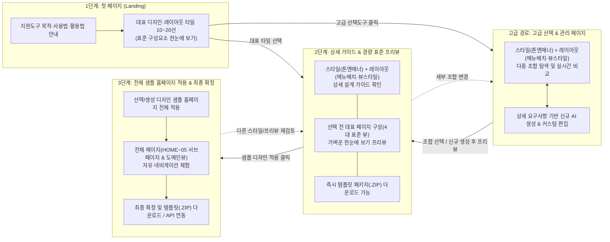

# 웹사이트 제작 지원도구 UI/UX 전면 개편(v4.0) 상세 설계 및 구현 계획서 (2026-11-07 14:06)

---

## 1. 개편 배경 및 핵심 목표 (Executive Summary)

### 1.1 현행 시스템(v3.0) 진단 및 문제점
1. **진입 화면의 과밀화와 혼란**:
   - 현재 `/templates/` 접속 시 지원도구의 안내 페이지 없이 곧바로 샘플 홈페이지(TheWayWorks)와 상단 스튜디오 컨트롤러(2줄의 칩 리스트 + 3단 드로어 + 도메인 스테이지)가 한 화면에 겹쳐 나타나, 사용자가 무엇부터 해야 할지 직관적으로 파악하기 어렵습니다.
2. **단계적 의사결정 흐름(Progressive Disclosure)의 부재**:
   - 스타일이나 레이아웃을 선택하기 전에 **"이 디자인의 표준 구성요소(메뉴 배치, 뷰 스타일, 톤앤매너)가 어떻게 생겼는지"** 가볍게 대표 페이지로 먼저 확인하는 프리뷰 단계가 없고, 즉시 무거운 전체 샘플 사이트가 통째로 바뀌어 탐색 피로도가 높습니다.
3. **스타일 가이드와 레이아웃의 UX적 개념 미분리**:
   - **스타일 가이드(Tone & Manner 중심: 분위기, 어조, 컬러, 서체)**와 **레이아웃 디자인(메뉴들의 배치 & 바디 뷰 스타일 중심)**이 사용자 관점의 직관적 분류 체계로 정리되어 있지 않습니다.

### 1.2 개편 목표 (v4.0 — 4단계 워크플로우 기반 고접근성 UI/UX)
사용자의 접근성과 사용성을 극대화하기 위해, 어플리케이션 전체를 **일관된 4단계 사용자 여정(User Journey)**으로 전면 재설계합니다.

---

## 2. 6대 요구사항별 UI/UX 상세 아키텍처 설계

### [요구사항 1 & 2] 첫 페이지 (`#app-view-landing`): 세련된 목적·활용 안내 + 대표 타일(10~20개) 쇼케이스

#### 2.1.1 상단 헤더 & 목적·사용법·활용방법 히어로 섹션 (첫째 요구사항)
- **전용 앱 내비게이션 바 (App GNB)**:
  - 좌측: `DESIGN & LAYOUT STUDIO` 브랜드 로고 및 버전 배지
  - 중앙 스텝 인디케이터(Step Breadcrumb):
    - `① 대표 타일 탐색 (첫페이지)` ➔ `② 상세 가이드 & 표준 프리뷰` ➔ `③ 전체 샘플 홈페이지 네비게이션` (우측 별도 버튼: `🎛️ 고급 스타일·레이아웃 관리 도구`)
- **세련된 온보딩 히어로 & 가이드 섹션**:
  1. **지원도구의 목적 (Purpose)**:
     - *"1인 기업·스냅 컴퍼니의 브랜드 톤앤매너(스타일 가이드)와 서비스 화면 구조(메뉴 배치·뷰 스타일)를 직관적으로 조합·검증하고, 즉시 실행 가능한 웹사이트 템플릿 패키지를 생성하는 디자인 지원 도구입니다."*
  2. **3단계 사용법 (How It Works)**:
     - **Step 1. 탐색 및 조합**: 대표 타일(10~20선)을 한눈에 비교해 고르거나, `[고급 선택도구]`에서 상세 요구사항에 맞게 조합/AI 생성합니다.
     - **Step 2. 상세 가이드 & 경량 표준 프리뷰**: 선택한 스타일의 톤앤매너와 메뉴 배치·뷰 스타일 가이드를 확인하고, 4개의 표준 대표 페이지 프리뷰로 한눈에 검토합니다.
     - **Step 3. 전체 샘플 홈페이지 네비게이션 & 다운로드**: 샘플 홈페이지에 디자인을 최종 적용하여 전체 메뉴를 실제처럼 네비게이션해 보고 `.ZIP` 템플릿 패키지를 다운로드합니다.
  3. **3대 활용 방법 (Use Cases)**:
     - `📦 웹/랜딩페이지 즉시 구축`: 완성형 HTML/CSS/JS 및 디자인 토큰 패키지(`.ZIP`) 다운로드 후 즉시 배포
     - `🤖 AI 바이브코딩 가이드 주입`: 패키지 내 `CI_AND_STYLE_GUIDE.md`를 Cursor, Claude, Gemini 등 AI 코딩 도구에 프롬프트로 제공
     - `🔗 외부 앱 API / CSS 토큰 연동`: `/templates/api/styles/{id}/tokens.css` 엔드포인트를 외부 웹앱 `<link>`로 직접 참조

#### 2.1.2 대표 스타일 가이드 & 레이아웃 타일 쇼케이스 (10~20개 한눈에 보기) (둘째 요구사항)
- **타일 쇼케이스 뷰 모드 전환 탭**:
  - `🌟 대표 스타일 가이드 10선 (톤앤매너 중심)` — 기본 활성 탭, 10개 대표 스타일 타일을 한눈에 깔끔한 반응형 그리드(데스크톱 5열×2행 또는 3~4열 카드 그리드)로 표시
  - `📐 대표 레이아웃 10선 (메뉴 배치 & 뷰 스타일 중심)` — 10개 대표 도메인 레이아웃 타일을 와이어프레임 다이어그램과 함께 한눈에 표시
  - `🧩 전체 대표 타일 20선 통합 보기 (10 스타일 + 10 레이아웃/추천조합)` — 20개 대표 타일을 한 페이지에서 한눈에 조망
- **각 대표 타일(Visual Tile Card)의 구성요소 (표준 구성요소를 한눈에 볼 수 있는 미니 프리뷰 구조)**:
  - **상단 미니 웹 프리뷰 캔버스**:
    - 해당 타일의 실제 `background`, `surface`, `primary`, `accent`, `text_main` 컬러와 `heading_font`, `border_radius`, `shadow`가 실시간 적용된 **미니 웹페이지 축소판(미니 메뉴바 배치 + 히어로 슬로건 + 2열 카드 + CTA 버튼)** 렌더링
  - **중단 메타 정보**:
    - 스타일 번호 및 국/영문 명칭 (`01. 미니멀 에센셜`, `02. 테크 네오 브루탈리즘` 등)
    - 한 줄 톤앤매너 요약(Tagline) 및 핵심 정체성 키워드 칩(형용사 3개 · 동사 2개)
    - **5색 컬러 팔레트 스와치 바** + **대표 타이포그래피 명칭** + **기본 매칭 레이아웃(메뉴배치/뷰스타일) 배지**
  - **하단 즉각 액션 바**:
    - `[🔍 상세 가이드 & 표준 프리뷰]` (Primary — 클릭 시 Stage 2로 이동)
    - `[📦 템플릿 다운로드]` (즉시 `.ZIP` 다운로드)

---

### [요구사항 3, 5, 6] 타일 선택 시 (`#app-view-detail-preview`): 상세 가이드 & 표준 구성 기반 대표 페이지 경량 프리뷰

사용자가 첫 페이지(또는 고급 관리 페이지)에서 타일을 선택하면 열리는 **핵심 검토 화면**입니다. 전체 샘플 홈페이지를 무겁게 띄우기 전에 **표준 구성요소(메뉴 구성, 레이아웃 뷰 스타일, 톤앤매너)를 한눈에 파악**할 수 있도록 좌우 2단(또는 상하) 스플릿 구조로 설계합니다.

#### 2.2.1 좌측 패널: 스타일 가이드(톤앤매너) & 레이아웃(메뉴배치·뷰스타일) 상세 설명 (셋째 & 다섯째 요구사항)
1. **🎨 스타일 가이드 상세 (Tone & Manner 중심)**:
   - **브랜드 정체성 키워드**: 형용사(Adjectives) 전체 태그, 동사(Verbs) 전체 태그, 추천 타깃 업종
   - **톤앤매너 & 대표 카피**: 커뮤니케이션 어조 가이드 및 대표 광고 슬로건 박스
   - **색상 팔레트 명세 (8종 토큰)**: Primary, Secondary, Accent, Background, Surface, Text Main, Text Muted, Border의 컬러 칩과 HEX 코드(클릭 복사)
   - **타이포그래피 & UI 규칙**: 제목/본문/포인트 폰트 샘플 텍스트, 카드 곡률(`border-radius`), 테두리(`border`), 그림자(`box-shadow`), 인터랙션 정의
2. **📐 레이아웃 디자인 상세 (메뉴 배치 & 뷰 스타일 중심)**:
   - **메뉴 배치 (Menu Placement)**:
     - 현재 결합된 레이아웃의 메뉴 위치 및 방식 분류 표시 (예: `상단 고정 GNB (6탭 멀티뷰)`, `좌측 고정 트리 사이드바`, `상단 멀티 카테고리 & 통합 검색바`, `상단 빠른 예매/필터 고정바`, `미니멀 플로팅 헤더`)
     - 헤더 포함 요소 명세 리스트
   - **뷰 스타일 (Body View Style)**:
     - 바디 콘텐츠의 시각적 배치 구조 분류 표시 (예: `교차형 스토리텔링 섹션 뷰`, `4열 고밀도 상품 카드 그리드 뷰`, `풀스크린 배너 + 수평 캐러셀 뷰`, `좌우 스플릿(지도/워크스페이스) 뷰`, `3단 포털 & 뉴스 피드 뷰`)
     - 그리드 규격 및 핵심 섹션 구성 설명
   - **레이아웃 빠른 전환 셀렉터**: 현재 스타일 가이드를 유지한 채 다른 레이아웃(메뉴 배치/뷰 스타일)을 바로 끼워보며 우측 표준 프리뷰 변화를 즉시 확인할 수 있는 퀵 셀렉터 제공
3. **🏢 브랜드 CI 입력 & 즉시 다운로드 박스**:
   - 회사명 / 로고 심볼 / 태그라인 실시간 입력란
   - **`[📦 이 스타일 가이드로 만들어진 템플릿 다운로드 (.ZIP)]`** 버튼 및 **`[🔗 API / CSS 토큰 참조]`** 버튼

#### 2.2.2 우측 메인 영역: 표준 구성 기반 [대표 페이지 경량 프리뷰] (여섯째 요구사항 핵심)
- **설계 의도**:
  - 최종 샘플 홈페이지(6개 전체 서브페이지 + 방대한 콘텐츠)로 들어가기 전에, **메뉴 구성(Head), 레이아웃(Body 뷰 스타일), 톤앤매너(색상/폰트/카드 스타일) 등 표준 구성요소를 기반으로 한눈에 볼 수 있는 4개의 대표 페이지 구성(Representative Standard Pages)**을 가볍고 선명하게 제공합니다.
- **뷰 모드 지원**:
  1. **`[한눈에 보는 4대 대표 페이지 보드 (2×2 Multi-Page Overview)]` (기본값)**:
     - 한 화면에서 아래 4개의 대표 페이지 구성을 2×2 카드로 동시에 조망하여 전체적인 웹사이트의 통일감과 구조를 3초 만에 파악!
  2. **`[개별 대표 페이지 탭 확대 프리뷰]`**:
     - 각 대표 페이지 카드를 클릭하거나 상단 탭을 누르면 해당 대표 페이지를 큰 화면으로 자세히 확인:
       - **대표 페이지 ① — `홈 & 메뉴/히어로 표준 구성 (Home & Hero + Menu Layout)`**: 선택한 메뉴 배치(상단 GNB / 좌측 사이드바 / 검색바 등) + 히어로 헤드라인 & 슬로건 + 핵심 KPI 지표 + 메인/보조 CTA 버튼
       - **대표 페이지 ② — `핵심 서비스 & 뷰 스타일 구성 (Service Catalog & Body View Style)`**: 선택한 바디 뷰 스타일(카드 그리드 / 캐러셀 / 좌우 스플릿 / 3단 피드 등)이 적용된 대표 서비스 카드 목록과 카테고리 탭/필터 UI
       - **대표 페이지 ③ — `브랜드 스토리 & 데이터/아키텍처 구성 (Storytelling & Process View)`**: 톤앤매너가 반영된 단계별 프로세스 파이프라인, 비교 표(Table), 아키텍처 요약 카드 구성
       - **대표 페이지 ④ — `고객 진단/문의 폼 & CTA 구성 (Interactive Form & Footer View)`**: 텍스트 입력창, 셀렉트 박스, 체크박스, 제출 버튼, 하단 푸터 등 표준 폼/인터랙션 UI 컴포넌트 구성
- **최종 단계 진입 CTA**:
  - 우측 상단 및 하단에 눈에 띄는 대형 버튼 배치:
    **`[🚀 샘플 디자인 적용 ➔ 전체 샘플 홈페이지 네비게이션으로 이동 (최종 확인)]`**

---

### [요구사항 4 & 5] 고급 선택 도구 (`#app-view-advanced-studio`): 스타일 가이드 × 레이아웃 조합 관리 및 신규 AI 생성 페이지

첫 페이지에서 대표 타일 10~20개 외에 상세 요구사항에 맞게 디자인을 고르거나 신규로 생성하고자 할 때 진입하는 **고급 디자인 스타일 관리 페이지**입니다.

#### 2.3.1 톤앤매너(스타일)와 메뉴배치·뷰스타일(레이아웃)의 명확한 2축 구성 (다섯째 요구사항)
고급 관리 페이지는 사용자가 직관적으로 조합을 설계할 수 있도록 **좌측 조합 컨트롤러 + 우측 실시간 멀티 프리뷰 & 관리 보드**로 구성됩니다.

| 구분 축 | 핵심 관점 | 세부 분류 및 필터링 기준 | 제공 기능 |
|:---:|:---|:---|:---|
| **축 1. 스타일 가이드** (Style Guide) | **톤앤매너 중심** (Tone & Manner) | - **브랜드 분위기(형용사)**: 미니멀한, 혁신적인, 따뜻한, 고급스러운, 역동적인 등 - **브랜드 행동(동사)**: 연결하다, 자동화하다, 창조하다, 신뢰를 주다 등 - **컬러 무드**: Light 모드 / Dark 모드 / 비비드 / 파스텔 / 모노톤 - **타이포그래피**: 산세리프(모던) / 세리프(에디토리얼·럭셔리) / 브루탈·모노 | - 전체 스타일 타일 비교 선택 - 정체성 키워드 매칭 점수 자동 계산 - **신규 톤앤매너 스타일 AI 생성 & 커스텀 편집 (컬러 8종·폰트·보더 직접 수정)** |
| **축 2. 레이아웃 디자인** (Layout Design) | **메뉴들의 배치 & 뷰 스타일 중심** (Menu Placement & View Style) | - **① 메뉴 배치 (Menu Placement)**:   · `Top GNB (상단 표준 메뉴바)`   · `Left Sidebar (좌측 고정 사이드바)`   · `Mega Category & Search (통합검색+다중카테고리바)`   · `Quick Action Bar (빠른 예매·필터 독바)`   · `Minimal Floating (미니멀 플로팅 헤더)` - **② 바디 뷰 스타일 (Body View Style)**:   · `Storytelling Sections (교차형 스토리텔링)`   · `Card Grid & Masonry (고밀도 카드/큐레이션 그리드)`   · `Hero + Row Carousel (풀배너+수평 캐러셀)`   · `Interactive Split View (좌우 분할 지도/워크스페이스)`   · `3-Column Portal Feed (3단 포털/뉴스 피드)`   · `One-Page Parallax (원페이지 스크롤)` | - 메뉴 배치 유형별 & 뷰 스타일별 필터링 - 11종 기본 레이아웃 + 커스텀 레이아웃 선택 - **신규 레이아웃(메뉴배치+뷰스타일) AI 생성 & 커스텀 편집** |

#### 2.3.2 고급 관리 페이지 내 일관된 사용자 흐름 (넷째 & 요약 요구사항)
1. **조합 탐색 & 비교 (Mix & Match Matrix)**:
   - 사용자가 좌측에서 `[스타일 가이드]` 하나와 `[레이아웃 디자인(메뉴 배치 + 뷰 스타일)]` 하나를 선택하면, 우측 캔버스에서 **조합된 웹사이트 스타일(표준 대표 페이지 4종 프리뷰 및 컬러·레이아웃 설계도)**을 한눈에 볼 수 있습니다.
   - 또한 **"추천 조합 퀵 매트릭스"**를 통해 선택된 요구사항에 맞는 다양한 `[스타일 × 레이아웃]` 조합 후보들을 타일 형태로 나란히 비교할 수 있습니다.
2. **신규 요구사항 기반 AI 생성 및 상세 편집 (AI & Custom Studio)**:
   - 기존 목록에 없는 상세 요구사항이 있을 경우, 상단 `[+ ✨ 신규 요구사항으로 디자인/레이아웃 생성 (AI & 직접 편집)]` 탭을 열어:
     - 자연어 요구사항 프롬프트(예: *"친환경 비건 코스메틱 브랜드를 위한 올리브 그린 톤앤매너 스타일"*, *"좌측 고정 메뉴와 우측 3열 매거진 카드 뷰 스타일을 가진 레이아웃"*)로 **Gemini AI 초안 즉시 생성**
     - 세부 컬러 피커, 폰트, 메뉴 항목, 바디 그리드 아키타입 수정 후 저장
3. **프리뷰 구성 ➔ 샘플 홈페이지 적용으로 이어지는 일관된 파이프라인**:
   - 고급 관리 페이지에서 선택한 조합이나 신규 생성한 디자인도 단절 없이:
     - **`[🔍 표준 대표 페이지 프리뷰로 상세 검토 (Stage 2)]`**
     - **`[🚀 이 조합을 샘플 홈페이지 전체에 적용하기 (Stage 4)]`**
     - **`[📦 현재 조합 템플릿 패키지 다운로드 (.ZIP)]`**
     버튼을 통해 대표 타일 선택 시와 100% 동일한 흐름으로 이어집니다.

---

### [요구사항 6] 샘플 디자인 적용 후 (`#app-view-full-sample`): 전체 샘플 홈페이지 네비게이션 & 최종 확정

사용자가 Stage 2(표준 프리뷰) 또는 Stage 3(고급 관리 페이지)에서 **`[🚀 샘플 디자인 적용 (전체 샘플 홈페이지 보기)]`**를 클릭했을 때만 진입하는 **전체 샘플 홈페이지 구동 화면**입니다.

#### 2.4.1 슬림 플로팅 컨트롤 헤더 (Slim Floating Action Bar)
- 기존의 복잡했던 상단 2줄 스트립과 드로어를 완전히 없애고, 최상단에 **48px 높이의 세련된 다크 글래스모피즘 슬림 바**만 고정 배치합니다:
  - **좌측**: `[◀ 상세 가이드 & 표준 프리뷰로 돌아가기]` 버튼, `[🏠 첫페이지(대표 타일)]` 버튼
  - **중앙**: 현재 적용된 조합 배지 — `🎨 스타일: [선택된 스타일명 + 컬러닷]` × `📐 레이아웃: [선택된 메뉴배치·뷰스타일명]` + `[뷰 전환: 도메인 레이아웃 뷰 / 표준 6메뉴 기업 뷰]`
  - **우측**: `[🎛️ 고급 조합 변경]`, `[🔗 API/토큰]`, **`[✅ 최종 확정 & 템플릿 다운로드 (.ZIP)]`**

#### 2.4.2 전체 페이지 자유 네비게이션 (Full Sample Site Navigation)
- 선택된 디자인 스타일(톤앤매너)과 레이아웃(메뉴 배치 & 뷰 스타일)이 완벽하게 적용된 상태에서:
  1. **TheWayWorks 전체 6대 메뉴 페이지 네비게이션**:
     - `HOME (메인 랜딩 — 히어로, 6컷 카툰, 4대 핵심 축, 4대 코어 엔진 탭, DIKW 피라미드, 12종 카탈로그)`
     - `01 회사소개 (THE WAY)`
     - `02 쉬운 기술원리`
     - `03 맞춤 솔루션`
     - `04 실제 작동사례 (포트폴리오 필터링)`
     - `05 3분 무료진단 (인터랙티브 상담 신청 폼)`
  2. **선택된 레이아웃(Head & Body) 라이브 인터랙티브 뷰**:
     - 무신사형 이커머스 그리드, 넷플릭스형 OTT 캐러셀, 노션/슬랙형 좌측 사이드바 워크스페이스, 에어비앤비형 지도 스플릿 등 선택된 메뉴 배치와 바디 뷰 스타일 안에서도 모든 탭·검색·필터·모달·페이지 이동을 자유롭게 테스트하고 최종 확정할 수 있습니다.

---

## 3. 데이터 및 코드 수정 범위 (Technical Implementation Plan)

### Step 1: 레이아웃 & 스타일 메타데이터 보강 (`app.py`, `data/layouts_metadata.json`, `static/js/design-helper.js`)
- 각 레이아웃 메타데이터에 사용자의 이해를 돕는 직관적 분류 속성 2가지를 명시적으로 추가/매핑:
  - `menu_placement_ko` / `menu_placement_type`: 메뉴들의 배치 방식 (예: `"상단 고정 표준 GNB형"`, `"좌측 트리 사이드바형"`, `"상단 멀티 카테고리 & 검색바형"`, `"상단 빠른 액션/예매 고정바형"`, `"미니멀 플로팅 헤더형"`)
  - `view_style_ko` / `view_style_type`: 바디 뷰 스타일 (예: `"교차형 스토리텔링 섹션 뷰"`, `"고밀도 카드 그리드 뷰"`, `"풀배너 & 수평 캐러셀 뷰"`, `"좌우 스플릿(지도/워크스페이스) 뷰"`, `"3단 포털 & 뉴스 피드 뷰"`, `"원페이지 패럴랙스 스크롤 뷰"`)
- 백엔드 API(`/templates/api/styles`, `/templates/api/layouts`, `/templates/api/styles/{id}/package`, `/templates/api/styles/{id}/download`)는 하위 호환성을 100% 유지하면서 신규 속성까지 포함하도록 보강.

### Step 2: 프론트엔드 HTML 구조 전면 개편 (`static/index.html`)
- 기존의 복잡했던 `<aside class="dh-studio-wrapper">`(2줄 칩 스트립 + 3단 드로어)를 제거하고, 깔끔한 **단일 상단 워크플로우 내비게이션 바(`#dh-app-navbar`)**와 **4대 화면 컨테이너**로 재구성:
  1. `#dh-stage-landing` (Stage 1: 목적·사용법·활용법 히어로 + 대표 스타일/레이아웃 타일 10~20선 그리드 + 고급 선택도구 진입 카드)
  2. `#dh-stage-preview` (Stage 2: 좌측 스타일[톤앤매너] & 레이아웃[메뉴배치·뷰스타일] 상세 가이드 및 템플릿 다운로드 + 우측 표준 구성 기반 4대 대표 페이지 경량 프리뷰 보드)
  3. `#dh-stage-advanced` (Stage 3: 고급 선택 & 디자인 스타일·레이아웃 조합 관리 페이지 — 톤앤매너 필터 × 메뉴배치·뷰스타일 필터 + 실시간 조합 시뮬레이터 + Gemini AI 신규 생성/커스텀 편집기)
  4. `#dh-stage-sample-site` (Stage 4: 최종 디자인 적용 후 전체 샘플 홈페이지 네비게이션 컨테이너 — 기존의 `#dh-layout-live-wrapper`, `#standard-site-header`, `#view-home` ~ `#view-contact`, 푸터를 이 컨테이너 내부로 캡슐화하여 Stage 4 진입 시에만 노출)

### Step 3: 세련된 UI 스타일시트 재작성 (`static/css/design-helper-ui.css`)
- 첫 페이지의 세련된 온보딩 히어로, 3단계 사용법 카드, 대표 타일 그리드(미니 웹페이지 와이어프레임 썸네일 포함) 스타일링
- Stage 2의 좌우 분할 인스펙터 및 **4대 표준 대표 페이지 경량 프리뷰(2×2 멀티뷰 & 단일 확대뷰)** 스타일링 (현재 선택된 스타일 토큰 `--dh-*`가 표준 대표 페이지 프리뷰 내부에 실시간 반영되도록 스코프 설계)
- Stage 3의 고급 조합 관리 페이지(2축 필터·매트릭스·AI 생성 폼) 스타일링
- Stage 4의 48px 슬림 플로팅 확정 바 스타일링

### Step 4: 클라이언트 워크플로우 & 프리뷰 엔진 재구축 (`static/js/design-helper.js`)
- `switchAppStage(stageName, options)` 라우터 함수 구현 (`'landing'` | `'preview'` | `'advanced'` | `'sample'`) 및 브라우저 URL 쿼리/히스토리 연동
- `renderLandingRepresentativeTiles()`: 대표 스타일 10선 & 대표 레이아웃/조합 10선(총 20선)의 미니 웹 와이어프레임 타일 렌더링
- `renderDetailGuideAndStandardPreview(style, layout)`:
  - 톤앤매너 중심의 스타일 가이드 상세 + 메뉴 배치/뷰 스타일 중심의 레이아웃 가이드 렌더링
  - 선택 전 한눈에 보는 **4대 대표 표준 페이지(① 홈/메뉴/히어로, ② 서비스 카드 뷰, ③ 스토리/프로세스 뷰, ④ 문의 폼/푸터 뷰)** 경량 프리뷰 동적 렌더링
- `renderAdvancedStudioView()`: 고급 조합 시뮬레이터, 메뉴배치/뷰스타일 분류 필터, Gemini AI 신규 생성 및 커스텀 편집을 통합하고 `[표준 프리뷰 검토]` 및 `[전체 샘플 홈페이지 적용]`으로 일관되게 연결
- 통합 검증(Playwright / API 테스트)을 통해 4단계 모든 화면 전환, 대표 타일 선택, 표준 프리뷰 렌더링, 고급 조합/AI 생성, 전체 샘플 홈페이지 6개 메뉴 네비게이션, `.ZIP` 패키지 다운로드가 완벽히 동작하는지 검증.

---

## 4. 기대 효과 (Expected Benefits)
1. **직관적인 첫인상과 높은 접근성**: 처음 방문한 사용자도 지원도구의 목적과 3단계 사용법을 즉시 이해하고, 한눈에 들어오는 대표 타일(10~20개)을 통해 부담 없이 탐색을 시작할 수 있습니다.
2. **체계적인 의사결정 (표준 경량 프리뷰 ➔ 전체 사이트 네비게이션)**: 처음부터 복잡한 전체 샘플 사이트에 매몰되지 않고, 상세 가이드와 4대 표준 대표 페이지 프리뷰로 **톤앤매너·메뉴 배치·뷰 스타일**을 빠르게 검증한 뒤 최종 샘플 홈페이지 네비게이션으로 넘어갈 수 있습니다.
3. **초보자와 고급 사용자 모두 만족**: 빠른 선택을 원하는 사용자는 첫 페이지 대표 타일에서 3클릭 만에 완료하고, 상세 요구사항이 있는 사용자는 **고급 관리 페이지**에서 다양한 조합 실험 및 AI 신규 생성을 거쳐 동일한 프리뷰·적용 흐름을 일관되게 경험할 수 있습니다.
