# 정보설계(IA) 메뉴트리 & 객체화 컴포넌트 기반 Design & Layout Studio (v5.0) 설계 및 구현 계획서 (2026-11-07 15:24)

---

## 1. 정보설계(Information Architecture) — 3-Depth 메뉴트리 (기능 계층도)

사용자 목적에 가장 가까운 핵심 기능을 최우선(좌측 첫 번째)에 배치하고, 모든 메뉴 이동은 **1-Click**으로 이루어지며 최대 **3-Depth (`GNB ➔ LNB ➔ SNB`)**로 완결되는 메뉴트리입니다.

```mermaid
flowchart TD
    Root["🎨 Design & Layout Studio v5.0\n(최대 3-Depth · 1-Click Navigation)"]

    subgraph GNB["Depth 1: GNB (Global Navigation Bar — 목적 우선 배치)"]
        G1["1. 대표 템플릿 갤러리\n(Quick Showcase — 최우선 목적)"]
        G2["2. 정보설계(IA) & 레이아웃 배치도\n(Menu Tree & Component Reflow)"]
        G3["3. 스타일 적용 & 표준 프리뷰\n(Tone & Manner + 4 Representative Views)"]
        G4["4. 고급 조합 & AI 생성 스튜디오\n(Matrix & Gemini AI Builder)"]
        G5["5. 전체 샘플 사이트 & 패키지 출고\n(Full Live Site & ZIP/API)"]
    end

    Root --> G1 & G2 & G3 & G4 & G5

    subgraph LNB1["Depth 2 (LNB): 1. 대표 템플릿 갤러리"]
        L1_1["1-1. 대표 디자인 스타일 10선 (Tone & Manner)"]
        L1_2["1-2. 대표 레이아웃 아키텍처 10선 (GNB·LNB·SNB·뷰)"]
        L1_3["1-3. 웹디자인 기본 설계 가이드 & 사용법 (2p 이내 요약)"]
    end
    G1 --> L1_1 & L1_2 & L1_3

    subgraph LNB2["Depth 2 (LNB): 2. 정보설계(IA) & 레이아웃 배치도"]
        L2_1["2-1. 메뉴트리 & GNB·LNB·SNB·FNB 구조도"]
        L2_2["2-2. 정보 컴포넌트 레지스트리 (12대 객체 그룹)"]
        L2_3["2-3. 레이아웃별 컴포넌트 계층 재배치(Reflow) & 특화 뷰"]
    end
    G2 --> L2_1 & L2_2 & L2_3

    subgraph LNB3["Depth 2 (LNB): 3. 스타일 적용 & 표준 프리뷰"]
        L3_1["3-1. 4대 대표 표준뷰 프리뷰 (홈·카탈로그·스토리·폼)"]
        L3_2["3-2. 레이아웃별 특징적 뷰(Feature View) 단독 프리뷰"]
        L3_3["3-3. 스타일 가이드(컬러·폰트·어조) & CI 명세"]
    end
    G3 --> L3_1 & L3_2 & L3_3

    subgraph LNB4["Depth 2 (LNB): 4. 고급 조합 & AI 스튜디오"]
        L4_1["4-1. 스타일 × 레이아웃(GNB·LNB·SNB) 실시간 조합 보드"]
        L4_2["4-2. Gemini AI 디자인 스타일 생성 & 편집"]
        L4_3["4-3. Gemini AI 레이아웃 & 정보구조 생성"]
    end
    G4 --> L4_1 & L4_2 & L4_3

    subgraph LNB5["Depth 2 (LNB): 5. 전체 샘플 사이트 & 출고"]
        L5_1["5-1. 표준 기업 멀티뷰 (HOME ~ 05 무료진단)"]
        L5_2["5-2. 도메인 특화 레이아웃 풀스크린 뷰"]
        L5_3["5-3. 템플릿 패키지(.ZIP) 다운로드 & API 연동"]
    end
    G5 --> L5_1 & L5_2 & L5_3
```

---

## 2. 사이트 정보의 객체화(Objectification) 및 계층적 컴포넌트 레지스트리 설계

웹사이트를 구성하는 모든 정보를 **5대 계층 그룹(Component Groups)**과 **12개 표준 정보 컴포넌트 객체(`IC-01` ~ `IC-12`)**, 그리고 각 레이아웃의 고유 특징을 표현하는 **11개 레이아웃별 특징적 뷰 객체(`FV-00` ~ `FV-10`)**로 객체화하여 등록합니다.

### 2.1 5대 계층 그룹 및 12개 표준 정보 컴포넌트 객체 (`IC-01` ~ `IC-12`)

| 그룹 코드 | 계층 그룹명 | 컴포넌트 ID | 컴포넌트 객체명 | 핵심 속성 (Attributes) | 기본 배치 슬롯 |
|:---:|:---|:---:|:---|:---|:---:|
| **GRP-01** | **내비게이션 계층** (Navigation Tier) | `IC-01` | **GNB 글로벌 헤더 객체** | `brand_ci`, `depth1_menus`, `global_util` | `SLOT-GNB` |
| **GRP-01** | **내비게이션 계층** | `IC-02` | **LNB 로컬 내비게이션 객체** | `category_tabs`, `breadcrumb`, `sub_filter_bar` | `SLOT-LNB` |
| **GRP-01** | **내비게이션 계층** | `IC-03` | **SNB 사이드 내비게이션 객체** | `tree_menus`, `facet_filters`, `context_widgets` | `SLOT-SNB` |
| **GRP-01** | **내비게이션 계층** | `IC-04` | **FNB 푸터 내비게이션 객체** | `sitemap_columns`, `company_meta`, `status_badge` | `SLOT-FNB` |
| **GRP-02** | **핵심 가치 제안 계층** (Value Proposition Tier) | `IC-05` | **히어로 비전 & 슬로건 객체** | `eyebrow`, `headline`, `tone_sample_copy`, `cta_buttons` | `SLOT-HERO` |
| **GRP-02** | **핵심 가치 제안 계층** | `IC-06` | **핵심 성과 지표(KPI) 객체** | `live_app_count(12)`, `setup_speed(10s)`, `zero_install` | `SLOT-HERO-SUB` |
| **GRP-03** | **콘텐츠 & 카탈로그 계층** (Catalog & Service Tier) | `IC-07` | **프로덕션 카탈로그 그리드 객체** | `items(12종 스낵앱)`, `card_view_mode`, `sort_filter` | `SLOT-BODY-MAIN` |
| **GRP-03** | **콘텐츠 & 카탈로그 계층** | `IC-08` | **4대 코어 기술 부품 탭 객체** | `FOTOSTREAM`, `VDSTREAM`, `ShortURL`, `ProxyAuth` | `SLOT-BODY-MAIN` |
| **GRP-04** | **스토리 & 아키텍처 계층** (Story & Proof Tier) | `IC-09` | **6컷 카툰 & 4단계 배선 파이프라인 객체** | `cartoon_svg`, `pipeline_steps(Vibe→Wiring→Wisdom→App)` | `SLOT-BODY-SUB` |
| **GRP-04** | **스토리 & 아키텍처 계층** | `IC-10` | **Wisdom 지식검증 & 비교 테이블 객체** | `dikw_pyramid`, `dual_toc_verifier`, `spec_table` | `SLOT-BODY-SUB` |
| **GRP-05** | **고객 전환 & 특화 뷰 계층** (Conversion & Feature Tier) | `IC-11` | **3분 무료 진단 & 문의 폼 객체** | `biz_order_form`, `church_support_form`, `instant_submit` | `SLOT-CONVERSION` |
| **GRP-05** | **고객 전환 & 특화 뷰 계층** | `IC-12` | **레이아웃별 특징적 뷰(Feature View) 객체** | 선택된 레이아웃(`00~10`) 고유 정보구조 및 전용 인터랙티브 뷰 (`FV-00` ~ `FV-10`) | `SLOT-FEATURE` |

---

## 3. GNB · LNB · SNB · FNB 내비게이션 정의 및 화면/메뉴 간 관계

| 내비게이션 구분 | 화면 위치 및 높이/폭 규격 | 역할 및 포함 기능 | 하위 메뉴/컴포넌트와의 상호작용 관계 |
|:---:|:---|:---|:---|
| **GNB** (Global Navigation Bar) | 상단 고정 (`56px` 높이) | - 스튜디오 브랜드 로고 - **Depth-1 5대 목적 메뉴** (1.대표갤러리 / 2.IA·레이아웃설계 / 3.스타일·표준프리뷰 / 4.고급·AI스튜디오 / 5.전체샘플사이트) - 현재 선택된 `[스타일 × 레이아웃]` 상태 캡슐 및 `[.ZIP 다운로드]` | - GNB 메뉴(1-Click) 클릭 시 해당 섹션의 **LNB(Depth-2 탭 바)**와 **SNB(Depth-3 사이드 컨트롤러)** 구성이 동기화되어 즉시 전환됨 |
| **LNB** (Local Navigation Bar) | GNB 바로 아래 밀착 (`44px` 높이) | - 현재 선택된 GNB 대메뉴에 속한 **Depth-2 세부 뷰 탭(2~3개)**을 1-Click으로 전환 - 우측에 현재 뷰의 핵심 가이드 **툴팁(`ⓘ`)** 및 **확장 드로어 토글** 배치 | - 긴 페이지 스크롤 대신 LNB 탭 전환으로 화면을 분할하여, 모든 기능 설명과 카드가 **1~2 화면(Viewport) 이내**에 여유로운 여백과 함께 배치되도록 제어 |
| **SNB** (Side Navigation Bar) | 좌측 고정 사이드바 (`280px ~ 310px` 폭, 접기/펼치기 지원) | - **Depth-3 빠른 필터 & 객체 탐색기**:   · 현재 활성화된 스타일 가이드(톤앤매너) 퀵 스위처   · 현재 활성화된 레이아웃(GNB/LNB/SNB 구조) 퀵 스위처   · 정체성(형용사·동사) 및 메뉴배치/뷰스타일 필터   · 내 기업 CI(회사명·로고·슬로건) 입력 | - SNB에서 스타일이나 레이아웃을 1-Click 변경하면, 우측 메인 캔버스(대표 타일 / IA 재배치도 / 4대 표준 프리뷰 / 샘플 사이트)가 새로고침 없이 실시간 동기화됨 |
| **FNB** (Footer Navigation Bar) | 하단 슬림 바 (`48px ~ 64px` 높이) | - 현재 단계 요약, 전체 메뉴 빠른 점프(Sitemap Quick Links), REST API 문서(`/templates/docs`), 상태 배지, 다음 단계 바로가기 버튼 | - 어느 화면에서든 하단 FNB를 통해 다음 시나리오 단계나 API 인스펙터로 즉시 이동 가능 |

---

## 4. 레이아웃별 정보 컴포넌트 계층적 재배치(Reflow) 및 특징적 뷰(Feature View) 설계

각 레이아웃(`layout-00` ~ `layout-10`)을 선택할 때, **메뉴트리(GNB/LNB/SNB/FNB)**와 **정보 컴포넌트 객체(`IC-01` ~ `IC-12`)**가 어떻게 구조화된 방식으로 재배치되는지 정의합니다.

| 레이아웃 ID | 레이아웃 명칭 | GNB / LNB / SNB 배치 구조 | 컴포넌트 계층 재배치 (Component Reflow Rules) | 별도 생성되는 특징적 뷰 (`IC-12` Feature View) |
|:---:|:---|:---|:---|:---|
| `layout-00` | **표준 기업형 (더웨이웍스)** | `GNB(상단 6탭)` + `LNB(없음/섹션앵커)` + `SNB(없음)` + `FNB(5열 사이트맵)` | `IC-05(히어로)` ➔ `IC-09(6컷카툰)` ➔ `IC-08(4대부품)` ➔ `IC-10(Wisdom)` ➔ `IC-07(12종카탈로그)` ➔ `IC-11(진단폼)` 수직 교차 배치 | **`FV-00`**: 히어로 우측 **4단계 실전 Vibe-to-App 배선 파이프라인 카드** |
| `layout-01` | **이커머스 그리드 (무신사형)** | `GNB(통합검색+유틸)` + `LNB(1차 카테고리 멀티탭)` + `SNB(좌측 다중속성 필터 260px)` + `FNB` | `IC-03(SNB 필터)`가 좌측 고정 배치되고, `IC-07(카탈로그)`이 우측 **4열 고밀도 상품 그리드**로 최상단 승격 배치 | **`FV-01`**: **실시간 다중 속성 필터(타깃·엔진·가격) + RANK 배지·좋아요(♥)·장바구니 스토어 뷰** |
| `layout-02` | **OTT 스트리밍 (넷플릭스형)** | `GNB(투명 오버레이 미니멀 헤더)` + `LNB(장르 필터 칩)` + `SNB(없음, 풀블리드)` + `FNB` | `IC-05(히어로)`가 **100% 풀스크린 빌보드**로 확장되고, `IC-07`·`IC-08`이 **수평 스크롤 캐러셀(Row 1~3)**로 재배치 | **`FV-02`**: **풀스크린 오리지널 신작 빌보드 + 대한민국 TOP 10 아웃라인 넘버 수평 슬라이더 뷰** |
| `layout-03` | **예매·엔터 (메가박스형)** | `GNB(상단 메뉴)` + `LNB(밀착형 3-Step 빠른 예매 독바)` + `SNB(우측 예고편/이벤트 모듈)` + `FNB` | `IC-11(신청폼)`이 상단 LNB 위치의 **빠른 예매 위젯 바**로 승격 재배치되고, `IC-07`이 **박스오피스 1~8위 차트**로 변환 | **`FV-03`**: **상단 고정형 3-Click 빠른 스낵앱 개통 예매 바 + 즉시 티켓 발권 & 박스오피스 차트 뷰** |
| `layout-04` | **포털·미디어 (네이버뉴스형)** | `GNB(대형 검색 마스트헤드)` + `LNB(언론 섹션 탭바)` + `SNB(좌측 속보 타임라인 + 우측 지수 위젯)` + `FNB` | 화면이 **3단 비대칭 컬럼(`230px + 1fr + 290px`)**으로 분할되어 좌측 `IC-03(속보)`, 중앙 `IC-09·07(톱기사)`, 우측 `IC-06(실시간 지수 위젯)` 배치 | **`FV-04`**: **실시간 급상승 키워드 티커 + 3단 신문 편집 데스크(좌측 속보·중앙 헤드라인·우측 가동률 지수) 뷰** |
| `layout-05` | **SaaS 워크스페이스 (노션·슬랙형)** | `GNB(슬림 브레드크럼·⌘K 바)` + `LNB(문서 내 테이블/보드/문서 뷰 탭)` + `SNB(좌측 고정 폴더·채널 트리 265px)` | 상단 GNB가 최소화되고 **좌측 `IC-03(SNB 계층형 트리 메뉴)`**가 메인 내비게이션 역할을 수행, 우측 워크스페이스에 `IC-07·08·10`이 탭 전환 렌더링 | **`FV-05`**: **좌측 계층형 폴더·채널 트리(Tree Menu) + 우측 노션형 데이터베이스(테이블·칸반보드·문서) 스플릿 뷰** |
| `layout-06` | **여행·숙박 스플릿 (에어비앤비형)** | `GNB(중앙 알약형 조건검색 헤더)` + `LNB(아이콘 카테고리 바)` + `SNB(우측 고정 인터랙티브 지도 48%)` | 본문이 **좌우 50:50 스플릿**으로 분할되어 좌측에 `IC-07(2열 스테이 카드)`, 우측 SNB 슬롯에 **실시간 가격 마커 지도**가 연동 배치 | **`FV-06`**: **어디로·체크인·인원 알약형 검색 위젯 + 좌측 카드 리스트 × 우측 가격 핀(₩) 인터랙티브 맵 연동 뷰** |
| `layout-07` | **에듀테크 큐레이션 (인프런형)** | `GNB(강의찾기 드롭다운+검색)` + `LNB(난이도·스킬 태그 필터 바)` + `SNB(없음)` + `FNB` | `IC-05`가 **와이드 프로모션 슬라이더 배너**로 변환되고, `IC-02(스킬 태그 LNB)` 아래로 `IC-07·08`이 **커리큘럼·별점 카드 그리드**로 배치 | **`FV-07`**: **프로모션 배너 슬라이더 + 입문/실전/고급 기술스택 태그 필터 & 수강 평점(★5.0) 큐레이션 뷰** |
| `layout-08` | **채용·커리어 피드 (원티드형)** | `GNB(직군 카테고리 헤더)` + `LNB(직무·기술스택 태그 바)` + `SNB(우측 연봉/외주비 절감 계산기 340px)` | 좌측 메인(`1fr`)에 `IC-07(AI 디지털 부서원 채용 매칭 카드)`이 배치되고, 우측 SNB에 **인터랙티브 비용 절감 계산기**와 `IC-10(인사이트)` 배치 | **`FV-08`**: **직무별 AI 부서원 매칭 카드(합격보상·매칭률 99%) + 우측 실시간 외주비/인건비 절감 계산기 뷰** |
| `layout-09` | **프롭테크 풀스크린 맵 (직방형)** | `GNB(반투명 블러 플로팅 헤더)` + `LNB(원룸/투룸/오피스 유형 탭)` + `SNB(좌측 오버레이 슬라이드 매물 패널 380px)` | 화면 100%가 **풀스크린 지도 캔버스**로 전환되고, `IC-01·02`는 지도 위 플로팅 헤더로, `IC-07`은 **좌측 슬라이드 오버레이 패널**로 재배치 | **`FV-09`**: **100% 풀스크린 디지털 입지 지도(단지 클러스터 핀) + 좌측 플로팅 오버레이 매물 브리핑 패널 뷰** |
| `layout-10` | **브랜드 원페이지 스토리 (토스형)** | `GNB(초미니멀 글래스 헤더)` + `LNB(우측 챕터 앵커 닷 Chapter 01~04)` + `SNB(없음)` + `FNB` | 다중 컬럼을 제거하고 **단일 컬럼 풀뷰포트(Full-Viewport) 수직 서사 구조**로 `IC-05(비전)` ➔ `IC-09(프로덕트)` ➔ `IC-06(초대형 임팩트 지표)` ➔ `IC-11(초대 CTA)` 순차 배치 | **`FV-10`**: **초대형 타이포그래피 매니페스토 + 챕터 01~04 패럴랙스 스토리텔링 뷰** |

---

## 5. 유저 사용 시나리오 및 화면 레이아웃 개선 (여백·툴팁·2페이지 이내 구성)

1. **긴 텍스트 제거 및 툴팁(`ⓘ`) / 아코디언 확장(`▾`) 전면 적용**:
   - 모든 카드와 가이드 영역은 **핵심 키워드 + 시각적 배지 + 1줄 요약**만 기본 노출하여 충분한 여백(Whitespace)을 확보합니다.
   - 상세한 톤앤매너 해설, CSS 규칙, Head/Body 세부 명세는 **`[ⓘ 상세 설명 툴팁]`** 마우스오버 또는 **`[▾ 상세 명세 펼치기]`** 클릭 시에만 깔끔하게 열리도록 설계합니다.
2. **스크롤 최소화 (최대 1~2 페이지 이내 완결)**:
   - 한 페이지에 여러 섹션을 길게 쌓지 않고 **GNB(Depth 1) ➔ LNB(Depth 2 탭) ➔ SNB(Depth 3 좌측 패널) + 우측 메인 뷰**의 **App Workspace 레이아웃**을 적용하여, 사용자가 스크롤 없이 탭 클릭(1-Click)만으로 모든 기능을 탐색할 수 있도록 구성합니다.
